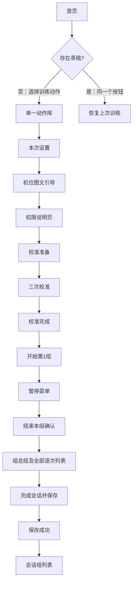
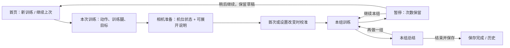

# 原生 App 流程与按钮审查 · 2026-10-15

用户重点：**流程绕、返回和按钮行为不清楚**。

> 这份报告保留修改前的问题证据。后续用户已授权实施，修复及最终验收见 [流程修复记录](NAVIGATION-UPDATE.md)。

结论：主流程能运行到保存，但导航规则和按钮语义有实质问题。当前优先级应是修正按钮去向、区分新建与恢复、减少进入训练的步骤，再调整视觉。此前修好的相机阻塞与本次导航问题是两类问题。

## 检查范围与证据

- 在这台 Mac 的 iPhone 17 Pro Max / iOS 26.5 Simulator 上操作实际 SwiftUI App，通过原生辅助功能节点点击并截图；不是浏览器原型。
- 共保存 **24 张原生截图**。01–14 为普通 App；15–25（没有 21）来自独立临时数据库的交互测试窗口，右上角明确标注“模拟姿态输入”。文件 18 的实际内容是结束本组确认。
- 亲自走过：启动、安全说明、隐私、首页、动作库、设置、机位、权限提示、无摄像头恢复、草稿恢复入口、空历史、个人设置，以及模拟输入下的三次校准、训练计数、暂停、结束确认、组总结、单次详情、保存、打开已保存会话、删除确认及取消。
- 模拟校准与计数使用 FixtureFactory 姿态观测，经过实际生产校准器和训练引擎生成结果；相机预览在这个测试窗口中没有真实画面。截图中的 5 次、2 条问题、fixture 引擎等均是测试结果，**不能作为真实动作识别、相机画质或准确率证据**。
- 本次没有操作最终删除，没有改动用户 iPhone 上的训练记录。未亲手覆盖：第二组、低质量姿态恢复、所有失败分支、小屏、Dynamic Type、VoiceOver 和手势返回。坐标滚动接口返回 noWindowsAvailable，后半程通过辅助功能激活按钮；没有据此声称验证了触摸区域和滚动手感。

## 当前实际路径

从无草稿首页到训练开始，需要点击：选择训练动作、选择保加利亚分腿蹲、继续检查机位、检查摄像头、继续并允许、开始校准、开始第 1 组，共 **7 个 App 内动作**，另需完成三次校准。首次系统权限弹窗、冷启动继续、安全说明未计入这 7 次。已授予权限时，代码仍会经过权限说明页。

## 优先问题

| 优先级 | 问题与实际后果 | 证据 | 建议行为 |
|---|---|---|---|
| P1 | 有草稿时，“选择训练动作”变成恢复入口；首页还同时有“恢复上次草稿”和“恢复上次训练草稿”。用户无法预期点击结果，也没有明确的新建入口。 | 截图 11、12；P0FlowModel.swift:174、235；P0Screens.swift:296 | 首页明确“开始新训练”和一张“继续上次训练”卡片；草稿存在时明确说明新训练如何处理旧草稿。不要把新建标签暗中改成恢复。 |
| P1 | 从安全说明点“查看隐私”，隐私页主按钮却是“返回我的”。实际进入个人页，可从训练 Tab 开始，原来的安全说明上下文丢失。 | 截图 02→03→04；manifest 中 P0-PRIVACY-LOCAL.nextState 固定为 P0-MY-LOCAL | 隐私作为可关闭详情，返回来源页；安全说明确认由独立状态控制。这里是流程一致性问题，不把它夸大为法律结论。 |
| P1 | “更换动作”“为什么需要侧面”“查看校准说明”没有对应的操作。第二轮原生 UI 逐项复现了下表结果。 | 截图 25；P0FlowModel.swift:233–271，manifest 相关 secondaryTarget 为 null | 每个按钮有明确动作类型与目的地；没有说明页的按钮先补说明内容，不应落入通用返回。 |
| P1 | 删除确认一面说“永久删除，无法撤销”，一面显示“已完成的重复不会自动丢失”。危险操作的后果被通用提示混淆。 | 截图 24；P0Screens.swift:699 | 删除确认只说明删除范围、不可恢复性，保留“取消”；移除训练暂停用的保留承诺。 |
| P1 | 组总结的全部逐次卡片排在保存、下一组操作之前。只有 5 次动作，首屏也看不到结束后的主要去向。列表越长，操作越靠后。 | 截图 19；P0Screens.swift:744–756 及 V3LightPage 的内容后动作栈 | 总结首屏给“再做一组”“结束并保存”，固定底部操作区；逐次证据放到可展开区或二级页。 |
| P2 | 已授权后仍显示权限说明；单一动作在首页和动作库重复选择。入口步骤多，但用户新增的决定少。 | 截图 05–09；P0-SESSION-SETUP→CAMERA-GUIDE→PERMISSION-REQUEST 固定链路 | 将动作和本次设置放在一页；仅权限未决定时提示授权；机位说明可在相机准备页展开，保留必要的机位与校准检查。 |
| P2 | 机位尚未检查，三项引导却显示绿色完成勾；AX 读成“已满足”。给用户错误的已验证暗示。 | 截图 08；DesignSystem.swift:331 默认 isComplete=true；P0Screens.swift:422 | 改成中性摆位提示；只有真实检查充分支持的条件才显示已满足，不能把文字要求当检测结果。 |
| P2 | 开发及设计说明直接露出，包括“01 核心与会话”“拒绝进入权限拒绝状态”“提供…三个明确层级”“失败进入删除失败”。恢复页也写“显示动作…草稿时间”，而非呈现这些信息。 | 截图 09、12、17、24；V3PageHeading 与 V3SheetStateScreen | 将设计元数据与用户文案分离；恢复卡实际展示时间、训练腿、已完成组/次数，操作说明只回答用户下一步。 |
| P2 | 多个页面右上角留有空白圆形控件；不是用户可理解的操作。 | 截图 03、07、19、23；P0Screens.swift:104–108、313、888 | 从 toolbar 结构移除隐藏的目录按钮，调试入口仅在专门模式出现。 |
| P2 | 暂停和退出都进入同一个大面板，标题仍问“暂停还是退出”；面板假拉手的视觉暗示与实际自定义页面结构不一致。暂停时已做出的选择又被重新询问。 | 截图 17；P0FlowModel.swift:244、472；P0Screens.swift:686 | 统一显示“训练已暂停”，说明当前第几组与保留次数；继续、本组结束、稍后继续、放弃分别说明数据结果。拉手只在支持相应手势的真实 sheet 中出现。 |
| P2 | 已保存会话中，组列表本身可点，下方又有“查看第 1 组”大按钮；删除是另一枚大按钮，阅读页主次关系偏向操作而非信息。 | 截图 23 | 组列表作为唯一查看入口；删除放进更多菜单，保留确认。 |

### 逐项复现的按钮错误

以下三项先由当前 manifest 与实际方法控制流联合定位，随后重新启动独立测试窗口，通过原生 UI 逐个点击复现。

| 页面 / 按钮 | 当前解析路径 | 结果 |
|---|---|---|
| 本次设置 / 更换动作 | secondaryTarget=null → performSecondary 的“修改/更换动作”分支 → P0-SESSION-SETUP | 指向当前页，不能回动作库 |
| 机位引导 / 为什么需要侧面 | 无专用分支、无 secondaryTarget → goBack | 正常前进路径中回到本次设置，未提供解释 |
| 校准准备 / 查看校准说明 | 无专用分支、无 secondaryTarget → goBack；needsCamera=true | 进入 P0-EXIT-MENU，未提供校准说明 |

共同原因是 **用展示文字 contains(...) 决定动作，未匹配时退回 goBack()**。更改文案可能改变行为，遗漏映射也不易显现。建议后续将动作定义成类型，例如 selectExercise、showCameraGuide、showCalibrationHelp、pauseGroup、finishGroup、saveAndExit；文案只负责显示。返回栈与会话的业务生命周期分别处理，不把所有状态都压进一个页面历史数组。

## 建议的流程与按钮约定

- 普通页面左上角“返回”：回到来源页，保留已填设置。
- 相机左上角关闭及暂停：都先进入清楚标注的暂停面板；关闭按钮的辅助功能标签应说明结果。
- “继续本组”：恢复当前组，不额外叠加一层“继续”页面；必要机位恢复检查在同一页显示状态。
- “结束本组”：保留已完成次数，进入组总结；可保留一次必要确认，但暂停菜单后不必层层确认。
- “稍后继续”：保留草稿并返回首页，首页显示可恢复内容。
- “结束训练并保存”：结束会话并生成历史记录；成功后直接给结果，不要求用户再理解“会话/组”的内部结构。
- “放弃本组”：明确删除的是当前组还是只丢弃未完成尝试；确认标题、数据承诺与实现必须一致。

这份建议不包含“跳过首次校准”或“放宽识别质量”。减少的是重复选择与解释页面，不是可靠识别所需条件。

## 逐屏评价

分数是本次针对流程、可理解性与可见布局的主观评价，满分 10；并非性能、可访问性认证或识别准确率。

| 页面 / 截图 | 分数 | 达到更好状态的具体改变 |
|---|---:|---|
| 启动 01 | 6 | 已完成引导后自动进首页，避免额外“继续” |
| 安全 02 / 隐私 03 | 4 | 隐私返回来源，确认路径完整；删除目录空白控件 |
| 个人 04 / 设置 14 | 6 | 减少重复标题；把设置写成具体可调整事项 |
| 空首页 05 / 有草稿首页 11 | 4 | 新建和恢复分开，显示真实草稿摘要，去重复入口 |
| 动作库 06 / 设置 07 | 5 | 单一动作和设置合并，修正“更换动作” |
| 机位 08 | 4 | 提示不冒充检查通过；说明图更准确，主要操作容易发现 |
| 权限说明 09 / 相机不可用 10 | 4 | 按真实授权状态分流，移除内部状态描述，错误页明确可行下一步 |
| 草稿恢复 12 | 4 | 展示草稿事实，明确新建/继续/返回，避免套用普通主页结构 |
| 空历史 13 | 7 | 一个明确开始入口，避免与返回首页重复 |
| 校准准备 15 | 5 | 说明按钮真正打开说明；进度、机位和操作层级简化 |
| 训练 16 | 6 | 保留易读计数与大按钮；提示改为面向训练者的简短行动语句 |
| 暂停 17 / 结束确认 18 | 4 | 说明当前状态和各动作后果，减少连续确认 |
| 组总结 19 | 4 | 保存/下一组首屏固定，逐次证据折叠 |
| 单次详情 20 | 5 | 优先显示可理解结论与建议；bottom、depth、targetDepth 等放进技术详情 |
| 保存成功 22 | 7 | 完成反馈明确；减少重复标题和空白装饰 |
| 会话详情 23 | 5 | 去掉重复“查看第 1 组”，弱化删除入口 |
| 删除确认 24 | 3 | 移除“不会丢失”矛盾承诺，说明真实删除范围 |

### 十个设计维度

| 维度 | 评价 | 依据与限制 |
|---|---|---|
| 字体层级 | 6/10 | 大字易读，但导航标题、眉题、主标题经常重复 |
| 间距与对齐 | 5/10 | 卡片整齐；机位/说明页占用过大，总结操作过深 |
| 色彩与对比 | 5/10 | 训练和普通页可区分；暂停面板蓝底提示的文字曾呈白色，可读性弱；未做仪器化对比测量 |
| 点击目标 | 未评分 | 大按钮视觉明显；本轮主要 AX 激活，没有完成触摸命中范围验证 |
| 加载、空、错误、完成态 | 5/10 | 存在相关页面；相机不可用可返回，保存反馈明确，但恢复和错误文案暴露元数据 |
| 可访问性 | 未评分 | 观察 AX 标签，已发现机位“已满足”的语义问题；没有完整 VoiceOver/Dynamic Type 测试 |
| 动画与切换 | 未评分 | 本轮不做性能判断；此前真机性能修复另有验证 |
| iOS 导航习惯 | 4/10 | 来源页丢失、空白 toolbar、假 sheet 拉手、Tab 与历史栈混用 |
| 信息密度与操作层级 | 4/10 | 训练开始前页面多，组总结把关键操作放在全部证据后 |
| 产品文案与视觉针对性 | 3/10 | 用户文案混入设计元数据，通用人物图不足以解释分腿蹲机位 |

## 验证和交付边界

- 本轮增加 `testInteractiveSimulatorDesignReview`：仅环境变量 `COACH_INTERACTIVE_DESIGN_REVIEW=1` 时运行，临时 SwiftData/草稿目录，明确黄色标识，真实生产流与模拟传感器输入结合。普通回归默认跳过，不在生产 App 中加入模拟计数模式。
- 交互审查测试正常通过，执行 256.583 秒、0 failures。之后补充测试窗口隐藏/恢复原窗口，避免辅助功能点击被遮挡的后台控件；该补充不修改产品导航。
- 补充后重新构建并运行完整模拟器集成套件：11 项中 6 项通过、5 项按条件跳过、0 failures；跳过项为 4 项真机相机测试和默认关闭的交互审查测试。随后开启交互窗口复核上述三个按钮，确认后台窗口节点已不再混入；第二轮交互测试也正常结束通过。
- 运行日志保存在本目录 evidence 中。回归测试与手工视觉判断分别记录；回归通过不意味着上述设计问题不存在。
- 本次交付是有截图与代码依据的审查及下一版流程建议。**本轮未实施产品导航重构**；此前真机相机性能修复仍保留。本地变更未提交、未推送。
