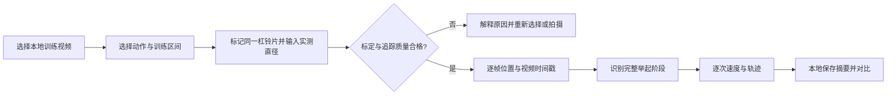
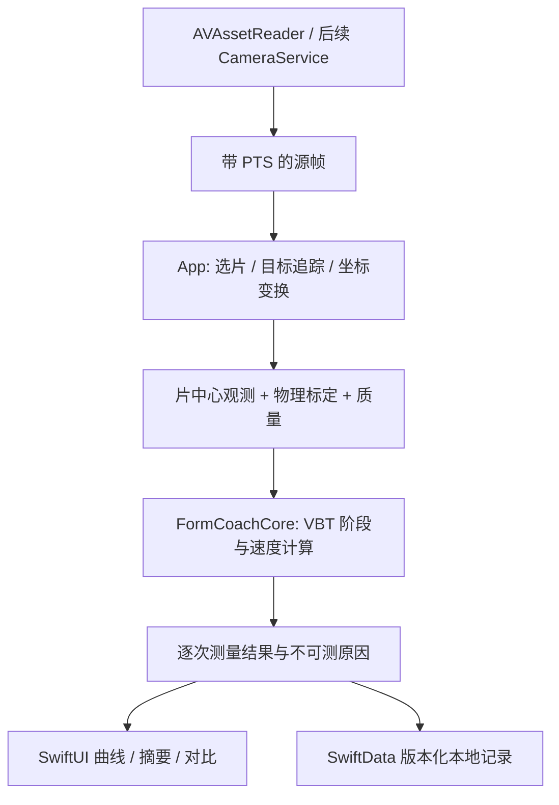

# 功能提案：手机摄像头杠铃测速与 VBT 分析

- 状态：提案；本 PR 仅添加设计文档，未实现测速，也未完成准确度验证。
- 日期：2026-10-15。
- 定位：在现有动作教练之外，增加端侧、单机位的杠铃运动测量模块。
- 功能参考：Arcus VBT 的视频测速和训练对比工作流；公开资料核验日期为 2026-10-15。

## 1. 要解决的问题

同样的重量和次数，不能完整反映每次举起的表现。用户希望看到杠铃举起的速度、组内变慢的程度，以及同重量跨组、跨日期的变化。

目标体验：手机固定侧拍，选择杠铃片、输入实际直径后，逐次展示平均垂直速度、运动范围和速度曲线。低质量片段明确标记为不可测，不用猜测补齐数据。测量信息辅助用户和教练判断，不直接推导动作正确、受伤风险或必须增减重量。

## 2. 与当前项目的关系

| 当前实现 | 对 VBT 的意义 |
| --- | --- |
| `App/CameraService.swift` 输出相机帧并使用 sample-buffer 时间戳 | 可复用采集基础，但当前受姿态推理忙碌状态控制的丢帧策略不能直接当作稳定测速采样 |
| `App/PoseAdapters.swift` 提取人体关键点 | 不提供杠铃片检测或米制尺度；髋部移动不能替代杠铃移动 |
| `Sources/FormCoachCore/WorkoutSessionEngine.swift` 处理分腿蹲阶段和计次 | 保持既有规则；另建杠铃测量领域逻辑，不复用其人体尺度标定作为片径标定 |
| `App/Services.swift` 使用 SwiftData 保存训练摘要 | 将来增加版本化 VBT 记录及迁移；当前运动 ID 固定为分腿蹲，需显式扩展 |
| README 和 ADR 0001 将 P0 限定为端侧单动作，且当前不保存视频 | VBT 是后续范围；启用视频导入或保存前需补充流程、隐私说明与相关 ADR |

本提案不改变既有 P0 的发布状态，也不把后续模块列为已支持动作。

## 3. 用户流程与首版范围

首版候选动作是侧拍杠铃深蹲；只有该动作通过验证后才扩大到卧推、硬拉。所有动作分别建立阶段定义、质量条件和验收数据，不能沿用单一动作的准确度结论。

| 阶段 | 交付内容 | 进入下一阶段的条件 |
| --- | --- | --- |
| V0：离线技术实验 | 本地视频、手动选片和片径、可修正轨迹、平均垂直速度与分析质量 | 在有授权的数据上验证标定、时间、分段及失败检测；不是产品发布 |
| V1：实验功能 | 单动作闭环、逐次列表、速度曲线、速度损失、本地历史与同条件对比 | 完成预先定义的独立测试集评估，明确支持设备和可辨别变化范围 |
| V2：实时反馈 | 实时追踪、组后速度播报、实时与导入结果一致性检查 | 采样吞吐、温升、掉帧和真机延迟满足目标设备预算；单独验证实时路径 |
| 后续研究 | 更多动作、峰值速度、重量—速度曲线、估算 1RM、导出 | 各自补充证据；测速通过不等于最大力量预测通过 |

首版不承诺奥举阶段拆解、弹跳分析、自动处方、云同步、多人或 3D 测量。

## 4. 如何计算速度

### 4.1 用片径把像素换成米

对同一画面平面，设实测杠铃片直径为 `D` 米，检测到的片径为 `d` 像素，则初始比例 `s = D / d` 米/像素。片中心的垂直像素变化乘以 `s` 得到垂直位移。

教学示例：直径 0.45 m 的片在画面中占 180 px，比例为 0.0025 m/px；上升 60 px 对应 0.15 m；若耗时 0.30 s，平均垂直速度为 0.50 m/s。这是示例计算，不是本项目实测精度。

- 片径来自实际测量，不能用重量猜测所有杠铃片尺寸。
- 使用源视频像素坐标；预览的旋转、镜像和 `resizeAspectFill` 裁剪必须做明确坐标变换。
- 固定侧面机位、完整可见的同一片、尽可能稳定的运动平面；缩放、机位变化、片目标切换或尺度明显漂移时要求重新标定。
- 单目 2D 测量无法恢复任意离面运动；斜拍、杠铃倾斜或向镜头移动不能简单视为已纠正。

### 4.2 位置和时间必须同时可靠

采用视频 presentation timestamp 的真实时间差，不能以“第几帧 ÷ 假定 30/60 fps”替代，尤其要覆盖可变帧率、丢帧和慢动作素材。保留原始 `CMTime` 精度；遇到重复或倒退时间戳、中断和过大采样间隔时，标记断点并阻止跨断点完成一次动作。

V0 可采用手动选定目标后进行 Vision 目标追踪，必要时允许修正并记录人工介入；自动片检测和 Core ML 模型是后续可评估路线，不是现有能力。追踪对象应是片中心，不能直接将抖动的检测框中心当作稳定真值。标定或追踪失败时不输出看似精确的速度。

### 4.3 固定指标定义

| 指标 | 首版定义与限制 |
| --- | --- |
| 平均垂直速度 MV | 完整向心阶段垂直位移除以该阶段耗时；不是沿曲线路径的平均速率 |
| ROM | 同一阶段的垂直位移，单位 m；需要有效尺度 |
| 速度曲线 | 位置经明确版本的滤波与差分得到；保留时间轴和质量掩码，不跨长缺口插值 |
| 速度损失 | `100 × (v_ref − v_i) / v_ref`，其中 `v_ref` 为本组首个完整、有效、正速度动作的 MV；不悄悄改用最快一次 |
| 无效或不确定结果 | 缺少尺度、时间或完整阶段时为缺失值与原因码；不得用 0 m/s 代表失败 |

速度损失的参考动作、负值和缺失规则要在 UI 中可查；负值表示比参考动作更快，不截断为零，也不把正值自动解释成生理疲劳。参考动作无效时明确换用后续首个有效动作，并告知用户。中途改变标定或拍摄条件时拆成新组。

起落架、放回架、半次动作和停顿需分别处理；向心起止点会影响 MV，算法阈值须在开发集确定、版本化后再进入测试集。不能把其他软件的阶段定义或阈值当作已验证标准。

## 5. 拟议技术结构

拟新增的接口与类型，不代表这些文件已存在：

- App 层：`BarbellTrackingAdapter` 处理 AVFoundation / Vision 或后续模型，不把平台依赖引入 core。
- Core 层：`PlateCalibration`、`BarbellObservation`、`BarbellVelocityEngine`、`BarbellRepMeasurement`；只接收位置、时间、标定和质量信息。
- 存储：`VBTSetRecord` 包含动作、可选重量、片径、标定、机型、视频时间信息、实际采样间隔、模式、算法/模型版本、原始与人工修正标记、逐次结果和失败原因。
- 失败状态至少区分：未标定、目标丢失、时间不连续、运动范围不完整、采样不足、拍摄条件变化。尚无法自动检测的条件应明确由用户确认，不能宣称已自动识别。

首版先串行消费本地视频。实时阶段评估独立的轻量追踪路径和有界调度，保留真实时间戳，记录实际观测间隔；不要让较慢的人体姿态推理决定杠铃测速采样率。姿态教练与 VBT 的反馈共同经过单一语音仲裁，不同时抢播。

默认只保存结构化摘要和必要测量证据；用户选择导入仅授予分析用途，不意味着另存永久副本或上传。原片删除后，摘要仍可读，回放和重分析应提示不可用。需要复制媒体时另设明确保存选项，沿用应用私有目录、路径校验和删除流程。测量链路不依赖 Gemini 或其他云端模型。

## 6. 准确度证据与产品声明

### Arcus 提供的是有限范围的参照

Arcus 官方公开 1 名参与者的 3 组、18 次配对读数：深蹲、卧推、硬拉，与 Enode 平均绝对读数差 0.015 m/s，15/15 相邻变化方向一致。记录对应 Arcus 1.0.7、iPhone 17 Pro、Live 侧拍；不是独立认证，Enode 也不是无误差真值。精确帧率等条件未提供，不能外推所有场景或软件版本。[1][2]

该数字既不能成为本项目的精度承诺，也不能直接设为验收结果。官网亦明确其他研究不独立验证 Arcus。本次检索未找到针对 Arcus 的独立同行评议验证。[1]

### 视频方法可行，不代表每个实现都同样准确

Renner 等的独立研究（2024）使用 20 名力量举选手、589 次动作及 Vicon 参照。Qwik VBT 的结果优于研究中部分其他 App，说明相同技术路线也可能存在显著实现差异。该研究未测试 Arcus，更未验证本项目。[3]

产品文案只能陈述本版本、特定动作/设备/拍摄条件下实际测得的表现。不得使用“与专业设备相同精度”“100% 准确”或“无需验证即可据此调整极限重量”等表述。

## 7. 验收与研究计划

### 工程正确性：可重复的确定性测试

- 已知像素位移和时间的合成轨迹：单位、片径缩放、正负方向与 MV 计算正确。
- 不规则时间间隔、丢帧、重复/倒退时间戳、暂停恢复：不积压、不跨断点生成完整动作。
- 源坐标到预览坐标的旋转、裁剪和镜像：目标位置与尺度一致。
- 失锁、遮挡、部分运动范围、重选片：产生明确缺失状态，不静默补全。
- 完整向心、停顿、半次和起落架：计次与阶段起止符合冻结后的动作定义。
- 速度损失：参考动作可追溯，覆盖参考无效、零值、负损失和缺失值。
- 旧 SwiftData 记录仍可读取；VBT 记录可保存、重启恢复及完整删除；未授权时无媒体持久化或上传。

### 测量有效性：真机与参照同步评估

1. 使用已验证的参照设备；条件允许时增加三维动捕。记录设备型号、校准、软件版本、指标定义及同步方法，不能仅比较两个 App 的相关系数。
2. 覆盖多人、多个负荷和速度区间、不同设备与允许拍摄条件，并加入遮挡、模糊、离面运动等失败素材。视频使用必须获得同意，不提交可识别训练素材到公开仓库。
3. 开发集与独立测试集按人划分；重复动作不是独立参与者。报告参与人数、组数、动作数、各层分母及置信区间；保留全部失败记录，不能只挑成功识别的动作。
4. 分动作、负荷、速度区间、设备和模式报告 bias、MAE、RMSE、Bland–Altman 一致性界限、漏识别/误识别率，以及测试—重测误差。清楚区分读数一致性、重复性与真实参照误差。
5. 先完成 pilot，依据目标场景冻结数值验收门槛、质量阈值和统计方案，再运行保留测试集；不得看过测试结果后修改门槛。当前尚无本项目的数值精度证据，因此不能标记验收通过。
6. 例如若目标是区分 0.50 与 0.45 m/s，就需验证这种 0.05 m/s 变化是否超过测量系统的最小可检测变化；这是设计目标示例，不是已验证的训练阈值。

发布实验功能前，必须有支持范围、冻结的数值门槛、测试结果和已知失败条件；达不到门槛时保持研究模式。重复分析同一视频只能检查处理一致性，不能替代真实准确度验证。实时模式在离线通过后仍需单独验收。

## 8. 实施任务拆分

- [ ] 明确单动作分段定义、视频导入/媒体保留规则和后续范围 ADR。
- [ ] 用合成轨迹完成 Core 标定、PTS、分段、缺失状态和指标测试。
- [ ] 打通离线选片、追踪、修正、轨迹叠加与质量提示。
- [ ] 建立有授权的 pilot 数据和同步参照流程，冻结独立测试方案。
- [ ] 完成版本化存储、单组展示和同条件历史对比。
- [ ] 发布实验评估记录，再决定实时追踪和更多动作的投入。
- [ ] 对峰值速度、重量—速度曲线、估算 1RM 等分别提出后续验收方案。

## 9. 公开来源

1. [Arcus Measurement Methods & Accuracy Evidence](https://arcusvbt.com/methodology)：开发方的方法与边界说明。
2. [Arcus vs Enode: team test results](https://arcusvbt.com/compare/enode)：开发方测试、配对读数及测试条件，不是独立研究。
3. [Renner et al., Concurrent validity of novel smartphone-based apps monitoring barbell velocity in powerlifting exercises](https://pmc.ncbi.nlm.nih.gov/articles/PMC11575817/)，PLOS ONE，2024，DOI: [10.1371/journal.pone.0313919](https://doi.org/10.1371/journal.pone.0313919)：独立研究，未测试 Arcus 或本项目。

以上来源仅用于解释可行性和验证要求；本提案的接口、阶段和交付安排属于本项目设计选择。
