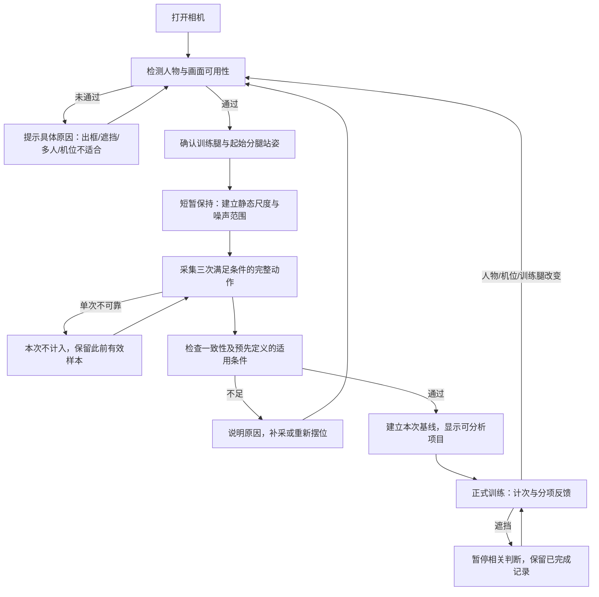

# 相机动作校准与反馈：技术调研和实施方案

调研日期：2026-10-15。适用项目：AI Form Coach；首个动作：保加利亚分腿蹲；设备：单台固定机位 iPhone。

本文区分三类内容：当前代码已实现的事实、官方文档/研究证据、尚待验证的工程方案。本轮只形成方案，不修改识别算法或声称识别精度已达标。

## 结论与范围

建议采用“端侧姿态估计 + 机位/可观测性检查 + 个体基线 + 时序状态机 + 有证据的反馈”。保留 Apple Vision 2D 作为现有基线，引入 MediaPipe Pose Landmarker Full 做同片对比；用真机数据决定是否替换默认引擎。Apple Vision 3D 是后续对照候选，不因名称含 3D 就直接升级。

“校准”有两种常见含义，本方案同时覆盖：开始前建立个人与机位基线；训练过程中识别动作偏差并提示。两者必须分开验收。识别到骨架不代表动作合格，三次重复一致也不代表动作正确。

第一版能力承诺：在受控单人侧面机位下辅助计次、比较本次训练的幅度/节奏变化、观察躯干整体倾角变化。膝内扣、骨盆旋转、腰椎屈曲、肌肉发力比例、关节负荷不列为本轮可可靠输出的指标。

## 1. 现有代码的真实状态

| 环节 | 当前实现 | 局限 |
| --- | --- | --- |
| 姿态引擎 | `App/CameraService.swift:40` 按编译条件选择引擎；当前工程未接入 MediaPipe SDK/编译开关，使用 Apple Vision 2D | `.task` 文件存在不等于 MediaPipe 已运行 |
| 关键点适配 | `App/PoseAdapters.swift:24` 调用 `VNDetectHumanBodyPoseRequest`，选出单一检测结果；当前映射 9 个点 | Apple 2D 本身能给更多点；当前没有脚跟、脚尖输出，也没有凳子检测 |
| 机位检查 | `App/P0FlowModel.swift:409` 检查双肩、双髋、双踝置信度 | 不检查膝、头部边界、侧视方向、后脚是否抬高或实际支撑关系；“全身关键点可见”措辞超出实际检查 |
| 三次校准 | `GuidedCalibrationCollector` 用肩髋中点、髋下降量和速度切分三次起落 | 单纯上下起落也可能满足轨迹；没有充分确认动作类型 |
| 基线 | `Domain.swift:123` 用三次中位数建立幅度、躯干变化、下降时长；最大/最小幅度比小于 1.35 | 1.35 是当前工程阈值，没有本项目的实测依据；动作重复错误也可能被吸收为正常基线 |
| 几何 | `Geometry.swift:19`、`:28` 直接使用归一化 x/y 计算角度；`PoseObservation` 无画面宽高 | 非正方形画面横纵尺度不同，角度和混合距离会失真 |
| 时序 | 平滑系数固定为 0.42；相位由归一化髋位移/速度主导 | 丢帧后滤波响应变化；膝角虽计算，但未参与主要相位判定 |
| 反馈 | 幅度阈值为个人基线的 0.98；触底为 0.90；躯干变化容许值为基线加 9/12/18 度；节奏用个人下降时长的 0.70 与 350ms 比较 | 都是现有启发式规则，不能当作已验证的专业训练标准 |
| 失跟踪 | 校准中某一帧不满足上层可靠性检查就把三次进度全部清零 | 单帧遮挡容易导致反复重来；应区分短缺失、当前重复失效和整个基线失效 |

现有结构有价值：相机采集、后台分析、引擎 actor、草稿、组总结均可复用。需补齐的是测量契约、质量门槛和验证闭环，无需重写全部 App。

### 一个可复现的几何问题

在 720×1280 图像中，假设两个点的像素位移 dx=100、dy=100，相对竖直角应为 45°。各自按宽高归一化后，直接计算 `atan2(100/720, 100/1280)` 得到约 60.64°。这是几何上的尺度错误，与模型精度无关；真实人体的最终偏差仍需回放评估。

先转换到经过方向校正的源图像像素坐标 `(x*W, y*H)`，或使用等尺度坐标 `(x*W/H, y)` 再计算角度/距离。归一化位移与人体尺度也必须来自同一坐标系。修正像素尺度仍不能消除透视和离平面运动误差。[Apple 的坐标说明](https://developer.apple.com/documentation/vision/detecting-human-body-poses-in-images)

## 2. 候选技术及证据边界

| 方案 | 已核实能力 | 本项目判断 |
| --- | --- | --- |
| Apple Vision 2D | 系统框架，最多 19 个人体点，归一化 2D 坐标和置信度 | 现有基线；先修测量链与质量检查。足部信息有限，不能据此评估脚跟接地 |
| MediaPipe Pose Landmarker | 33 点，含脚跟/脚部点；图像坐标与 world coordinates；有 iOS 实时流接口 | 优先做对照验证，特别比较侧面遮挡、左右腿身份、足部稳定性。尚无证据证明它在本项目动作上优于 Vision |
| Apple Vision 3D | 17 个关节，单图估计 3D；无深度时人体尺度可能使用参考身高 | 可做第三条实验支线；3D 不等于物理实测，不假定能解决遮挡或直接给出准确厘米 |
| MoveNet | 官方提供 Lightning/Thunder，17 点 | 备选；当前不优先引入另一套运行时，足部细节也未覆盖本项目主要缺口 |
| 多机位/深度 | OpenCap 用两台或更多手机结合建模验证运动学/动力学 | 可供以后实验室对照；不符合首版单手机、离线、简操作的目标，不能照搬其精度数字 |

来源：[Apple 2D](https://developer.apple.com/documentation/vision/detecting-human-body-poses-in-images)、[MediaPipe 模型与输出](https://developers.google.com/edge/mediapipe/solutions/vision/pose_landmarker)、[Apple WWDC23 3D](https://developer.apple.com/videos/play/wwdc2023/111241/)、[MoveNet 官方教程](https://www.tensorflow.org/hub/tutorials/movenet)、[OpenCap 原论文](https://journals.plos.org/ploscompbiol/article?id=10.1371/journal.pcbi.1011462)。

MediaPipe 的 `landmarks.z` 与 `worldLandmarks` 不是同一种坐标；前者以髋部深度为参照且尺度近似 x，后者是模型输出的米制 3D。当前适配器只读前者。若接入 3D，需单独字段和坐标声明，禁止把当前 z 直接当米。参见 [iOS 官方输出定义](https://developers.google.com/edge/mediapipe/solutions/vision/pose_landmarker/ios)。

不建议把逐帧大模型看图作为计次/校准主链路。这是针对本项目响应、连续性、可回放验证与端侧处理需求的工程判断，并非声称所有视觉大模型都不能分析运动。以后可用于离线解释经过验证的结构化结果。

## 3. 相机打开后的完整流程



### A. 机位与可观测性检查

不是亮一个“检测到人”就允许校准，而是回答：能否从当前画面测量所需指标？

- 画面包含单一目标人物，训练腿的髋、膝、踝可用；头脚边界在画面内。头部仅用于取景检查，不要求把完整面部点全部识别。
- 检查相机画面方向、镜像、宽高比与预览裁切。骨架叠加必须用源图像到 `resizeAspectFill` 预览的同一变换。
- 训练腿由用户确认，结合前后脚几何检查，不把画面左侧当成人体左腿；不在组内随意切腿。
- 肩/髋重叠程度可作侧视的辅助信号，但不能单凭它证明侧视正确，也不能强求远侧所有点一直高置信度。按“训练腿可见性”选择可分析项目。
- 后脚抬高、前后脚位置与跨帧脚部稳定可作姿态线索；仅有骨架不能证明脚实际压在凳面或地面。无法确认支撑关系时让用户确认站姿，不伪称自动识别了凳子。
- 多人策略：Vision 的已检测结果数可作门槛，不能保证检测到了画面所有人；MediaPipe `numPoses=1` 不能用来排除多人。可配置最多检测两人来发现第二目标，或加低频人员检测，并验证性能。
- 取景距离以完整可见和识别稳定为准，不统一写死几米。Apple 文档建议人物高度至少约图像的三分之一；本项目更具体的占比范围需要实测。

上面依赖可见性和视角的边界，分别依据 [Apple 准确性建议](https://developer.apple.com/documentation/vision/detecting-human-body-poses-in-images) 和 [Google 对 2D 角度随视角变化的说明](https://developers.google.com/ml-kit/vision/pose-detection/classifying-poses)。具体组合门槛是本项目待验证的方案。

### B. 静态基线：适应人体、尺度与噪声

用户在分腿准备姿势保持短暂稳定，采集髋/肩、可见腿长、起始膝角、躯干倾角、脚部位置、画面人物尺度，以及关键点抖动范围。采用稳健中位数/分位数，不用单帧最大值决定起点。

起始可试验稳定窗口 1–2 秒。这是待调的交互参数，不是论文证明的必要时长。手机陀螺仪/姿态变化可辅助检测机位被移动；单靠人体整体位移不能区分手机动了还是人动了。必要时结合低频背景运动检查。

不要求用户输入身高就声称完成物理空间标定。2D 角度、相对幅度可以不依赖厘米；厘米和绝对 3D 测量是另一项能力。

### C. 动态基线：三次有效样本，不是三次任意起落

每次必须观察到完整序列：起始区 → 持续下降 → 可信底部/反向 → 持续上升 → 返回起始区。髋轨迹是主信号之一，同时检查训练腿膝/髋角变化、脚位置、人物身份与可见性。

先收集三次合格样本，可在不一致时有限补采；“三次”沿用当前交互，是初版工程选择，不是任何模型的准确性保证。短时间遮挡：冻结进度、排除坏帧；若影响当前动作关键阶段，仅作废当前重复；人物/机位/动作目标改变才清空整个基线。恢复时须重新观察稳定起始区，不跨缺失片段拼接一次完整动作。

样本需通过两个不同检查：

1. **是否稳定可重复**：幅度、起止状态、节奏、有效覆盖率的一致性。
2. **是否适合作为该分析项的参考**：由教练标注和验证集确定，不能由用户自己的三次中位数循环证明。

若只能确认一致性，UI 应显示“已建立本次动作基线”，不能显示“标准动作已认证”。无法建立有依据的动作质量参考时，可降低为计次/相对变化模式。

### D. 正式训练：计次和评价拆开

- 计次回答是否观察到一次完整周期；评价回答有哪些可靠、可解释的变化。未达到个人深度的尝试可单独记录为未完成尝试，不能凭不存在的底部补出一整次。
- 当前触底需达到目标的 90%，因此比这更浅的尝试可能在相位机中直接丢弃，导致“幅度偏小”只覆盖很窄区间。应明确完整次数与未完成尝试的产品定义，而不是盲调 0.90/0.98。
- 先实现相对基线的幅度/节奏变化与整体躯干角变化；“比校准时浅”“下降比本次参考明显快”比无验证依据的“动作错误”更准确。
- 肩髋线能描述整体躯干倾角，不能直接推出腰椎是否弯曲。内扣与骨盆旋转从侧面不可充分观察时，明确不评价。
- “偏臀/偏股四头”目前是用户选择的训练模式，不是从图像测得的肌肉发力比例；应由教练定义规则后分别验证，不能沿用任意增加几度就宣称有效。
- 每次最多一条优先反馈，设置冷却；证据不足优先提示“未看清膝部”，不触发动作纠错语音。

Google 提供基于姿态特征与状态进入/退出计次的示例，可作实现参考，但不是本项目动作标准。[ML Kit 分类与计次示例](https://developers.google.com/ml-kit/vision/pose-detection/classifying-poses)

## 4. 工程模块与数据契约

建议沿用 `LivePosePerception` 接口，逐步补入以下模块，不在主线程处理逐帧计算：

```text
AVCaptureSession
  → PoseProvider (Vision2D / MediaPipeFull / 可选 Vision3D)
  → CoordinateNormalizer
  → PersonTracker + ObservationQualityGate
  → 时间相关滤波 + FeatureExtractor
  → CalibrationCoordinator / RepetitionStateMachine
  → EvidencePolicy + FeedbackScheduler
  → 低频 UI 状态 / 本地结构化记录
```

### 最先修改的数据结构

`PoseObservation` 补充：方向校正后的源图像宽高、坐标系声明、镜像信息、personID/检测人数与语义、模型版本、采集时间/推理完成时间、可选独立 world landmarks、错误/丢帧原因。不能把 Vision 的 confidence 与 MediaPipe 的 visibility/presence 当同一分布，也不能把手写乘积当作“准确率 90%”。

`CalibrationProfileV2` 补充：schemaVersion、engine/modelVersion、ruleVersion、训练腿/目标、机位与画面签名、静态尺度、噪声范围、各特征的中位数与离散程度、样本数/覆盖率、可用分析项、失效原因。旧基线缺少必要坐标与引擎元数据时，要求重新校准；不要删除用户历史训练。

### 滤波与时序

固定 alpha EMA 的响应随采样间隔变化。可先改为基于时间差的 EMA，再与 One Euro Filter 对比。后者通过速度调整滤波强度，是成熟的交互滤波候选，但不能预先保证更适合所有动作。校准与训练必须共用同一特征/滤波链，防止参考值与使用时的滤波结果不一致。[原作者说明与论文入口](https://gery.casiez.net/1euro/)

状态进入/退出使用不同门槛、持续时间和恢复条件，避免底部抖动重复计次；所有时间判断基于采集 timestamp，不以帧数假设恒定 FPS。不要用长距离插值补足低置信度的底部或锁定阶段。

### 性能与故障

保持相机控制与推理后台执行，最多一个在途推理任务/有界最新帧队列，不积压旧画面。UI 与语音分别节流；如确需骨架叠加，用独立绘制层避免驱动全页 SwiftUI 重建。

MediaPipe 官方说明忙时会忽略新帧。当前适配器用 timestamp 保存 continuation，接入时需要验证丢帧、异常、取消、超时和迟到回调都能结束任务，避免相机永久停在处理中。现有单任务门槛降低了正常路径风险，但不能替代故障处理。[iOS 实时流线程与忙帧规则](https://developers.google.com/edge/mediapipe/solutions/vision/pose_landmarker/ios)

性能目标建议先设：有效分析频率至少 15Hz、从采集到状态更新的 P95 延迟低于 150ms、连续运行 20 分钟无逐渐积压。均为待验证的产品工程目标，不是目前测试结果；按实测调整分辨率、模型和绘制频率。

## 5. 专业标准和科学验证

姿态模型提供关键点，动作可接受范围需要领域标注。保加利亚分腿蹲研究通常还限定受试者、负重、站距、后脚高度与动作深度，不能把实验协议中的一个角度直接当所有人的统一纠错线。

例如 Mackey/Riemann 2021 是 20 名有训练经验男性的特定实验，包含专家确认动作与仪器测量；它可以帮助定义采样变量，但不能证明本项目现有 9/12/18 度、0.98 或 0.70 阈值。[原论文 PDF](https://intjexersci.com/files/ijes/vol14/iss1/10.pdf)

一项 MediaPipe 深蹲 2D 初步验证报告了髋部系统性偏差，并指出视角、硬件和照明的限制；这说明必须验证具体任务，不能从骨架画得像人就推出角度足够准确。该研究是普通深蹲，不能直接外推到保加利亚分腿蹲；本次网页直读受限，研究结果依据检索可见的原文结果/限制段落，未据此引用其具体误差数字。[研究原文](https://www.mdpi.com/2673-7078/6/1/1)

### 本项目数据集建议

先做用于发现问题的可行性集，再另建锁定测试集。初步可行性集可从 10–15 名不同体型/训练经验参与者开始；这仅是探索规模建议，不足以支撑面向全部用户的精度宣传。录像需另行明确获得同意，测试视频和关键点都不默认上传。

- 覆盖左右训练腿、不同衣着/背景/照明、真实分腿蹲、普通分腿蹲、站起坐下、弯腰、脚出框、他人经过、镜头移动及短暂遮挡。
- 同一视频离线送给不同引擎，避免分别拍摄造成动作和机位差异。实时延迟/热耗另用真实相机测，不能用离线回放推断。
- 至少对完整周期边界、失败原因、可见性和各项反馈由两名有资质/经验的教练按统一规则标注；意见不一致先裁决或标记不确定。
- 需要验证角度绝对准确性时，采用同平面的人工可审计测量或可靠仪器/多机位参考，说明二维与三维角的区别。不能仅把另一个神经网络输出当真值。
- 按参与者划分训练/调参/测试，避免把同一人的相邻帧或重复动作分到两边；报告不同场景分组结果，不只报一个总平均。

### 验收指标

| 能力 | 指标 | 初始验收提案（待实测确认） |
| --- | --- | --- |
| 校准 | 成功率、错误接受率、耗时 P50/P95、重试原因 | 首先证明普通起落/错误动作不能轻易通过；暂不捏造成功率 |
| 计次 | 每组绝对误差、重复级 precision/recall、误计次数 | 合格单人机位下，至少 95% 的测试组误差不超过 1 次，另报负样本误计；是目标而非结果 |
| 分项反馈 | 各类型 precision/recall、不确定/拒判比例、每组误报数 | 语音反馈 precision 初始目标 ≥95%，同时报告覆盖率与 recall，不能靠全部拒判达标 |
| 几何 | 可见关节角误差、姿态/机位漂移、左右标签切换次数 | 与教练定义的决策间隔比较，测量误差必须小于希望区分的变化；暂不编造统一角误差门槛 |
| 故障 | 出框/遮挡/多人/后台恢复后的状态 | 不增加虚构次数，不丢失已完成组，恢复后从可证实的起始状态继续 |
| 性能 | 有效 FPS、端到端延迟 P50/P95、热状态、掉帧、内存 | 15Hz / P95 <150ms / 20 分钟稳定，均为待验证目标 |

## 6. 实施顺序与交付物

| 阶段 | 具体工作 | 进入下一阶段的证据 |
| --- | --- | --- |
| 1 测量基础 | 统一坐标/方向/镜像契约；补采集元信息；完善调试骨架与关键点日志；建立视频回放工具 | 非正方形、旋转、镜像的几何用例正确；骨架覆盖源画面；记录可回放 |
| 2 真校准 | 机位质量门槛、训练腿确认、静态基线、分项采集三次、合理保留进度、基线失效机制 | 错误动作/错误机位不会轻易成功；失败提示具体；移动镜头后能要求重校准 |
| 3 引擎对照 | 接通并固定 MediaPipe SDK/模型；与 Vision 同片比较 | 关键点稳定、校准通过/误通过、计次和性能的完整对照表；选引擎有数据依据 |
| 4 分项反馈 | 教练定义可观察规则；先相对幅度/节奏/整体躯干变化，开放可信项目 | 锁定测试集上分项反馈达到预设指标；低证据时能正确不判断 |
| 5 实际使用 | 真机长时训练、恢复流程、UI/语音节流、不同环境 | 无积压、热降级可用、已完成记录不受影响；再扩大动作/设备覆盖 |

不先承诺工期：识别功能的不确定性主要在数据与动作规则验证。工程接通可估时，达到可宣传的准确性必须以测试集结果决定。

## 7. 本轮决策建议

先推进阶段 1 和阶段 2，建立可看见、可解释、可回放的校准闭环；与此同时采集小规模同意参与的样本，之后以阶段 3 结果决定默认模型。暂不自训端到端纠错模型、不引入逐帧云端大模型、不宣称单侧面图像能完成全身专业姿势认证。

当前项目里的模型和自动化测试能证明部分实现与流程成立，不能替代真实人、真实动作、教练标注的准确性验收。

## 一手资料清单

1. [Apple：Detecting Human Body Poses in Images](https://developer.apple.com/documentation/vision/detecting-human-body-poses-in-images) — 2D 点、坐标、取景限制。
2. [Apple WWDC23：Explore 3D body pose and person segmentation in Vision](https://developer.apple.com/videos/play/wwdc2023/111241/) — 3D 关节、参考尺度、深度元数据。
3. [Google：Pose Landmarker Overview](https://developers.google.com/edge/mediapipe/solutions/vision/pose_landmarker) — 模型、33 点、足部点与输出。
4. [Google：Pose Landmarker iOS Guide](https://developers.google.com/edge/mediapipe/solutions/vision/pose_landmarker/ios) — iOS 接入、实时流、忙帧、坐标。
5. [Google：Pose classification options](https://developers.google.com/ml-kit/vision/pose-detection/classifying-poses) — 特征、计次、2D 角度限制。
6. [BlazePose 原论文，2020](https://arxiv.org/abs/2006.10204) — 移动端人体关键点估计；不把其历史硬件速度当本项目结果。
7. [MoveNet 官方教程](https://www.tensorflow.org/hub/tutorials/movenet) — 17 点与模型选项。
8. [One Euro Filter 原作者页面](https://gery.casiez.net/1euro/) — 滤波调参与原论文。
9. [Mackey/Riemann 2021：BSS 与后蹲生物力学实验](https://intjexersci.com/files/ijes/vol14/iss1/10.pdf) — 研究协议、专业确认与适用人群。
10. [MediaPipe 深蹲 2D 初步验证，2026](https://www.mdpi.com/2673-7078/6/1/1) — 任务相关误差与限制；网页直读受限，未作为定量验收依据。
11. [OpenCap 原论文，2023](https://journals.plos.org/ploscompbiol/article?id=10.1371/journal.pcbi.1011462) — 多手机与模型验证的参照，不能直接移植到单手机方案。
