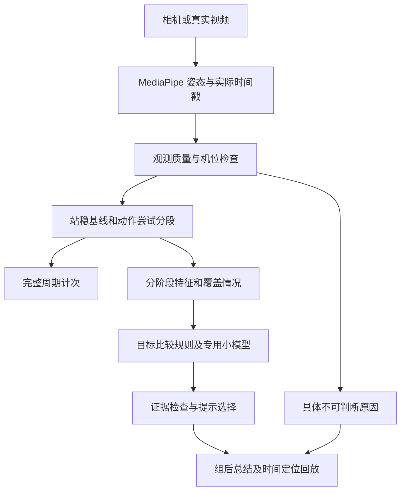

# 徒手深蹲动作反馈：落地计划

日期：2026-10-16。状态：待实施的工程计划；本文件不代表新增能力已经实现或验收。

首次实施进度：动作尝试记录、保守的阶段覆盖统计、Mac MediaPipe 到 Swift 回放、事实测量、节奏目标比较、总结/历史和回放证据入口已实现；详见[本轮实现与验证](../Testing/Squat-Coaching-2026-10-16/README.md)。以下仍保留为完整计划，未勾选任务不能解读为全部尚未开发；多人模型训练、盲测与真机验收尚未完成。

决策：在已有 MediaPipe、站稳检测、计次和录像回放上，增加动作尝试记录、可观测性判断和本动作专用的小模型。先在 Mac 离线验证，再做模拟器交互；iPhone 安装、启动和真机回归继续等待用户通知。

## 1. 当前基础与必须纠正的前提

依据：[本轮模型实测](../Testing/OnDevice-Model-Comparison-2026-10-16/README.md)、[已有动作反馈研究](2026-10-15-Squat-Quality-And-Coaching.md)及本日代码读取。

| 当前已有 | 实际边界 | 本次需要补齐 |
|---|---|---|
| iOS MediaPipe / Apple Vision 适配、骨架显示、具体识别失败原因 | 姿态识别不等于动作质量判断 | 按评价项目判断所需关节及关键阶段是否可见 |
| `SquatSession` 站稳基线与完整周期计次 | 站稳基线只定义起点及归一化尺度，不能教会系统什么是标准深蹲 | 可独立记录浅蹲、中断和未完整回起的动作尝试 |
| 实时、视频和关键点回放共用核心 | Mac 原生适配目前不提供 MediaPipe；Mac 骨架实验使用 Python | 把 Mac Python 的真实骨架送入同一 Swift 核心 |
| OfficeSquat 小分类器与约 10KB 权重导出 | 单人、特定举臂练习；10 段留出中的 8 段命中不代表多人侧面深蹲准确率 | 新数据、逐问题标签、人物隔离验证及部署一致性 |
| 训练总结与本地历史存储 | 当前徒手深蹲 `issues` 为空，界面明确只验证计次 | 增加可判断次数、事实证据、建议和不可判断原因 |

两个实现风险优先解决：

1. **只评价已计次动作会漏掉浅蹲。** 现有幅度不足的周期直接返回提示，没有 `RepSummary`；质量层不能只监听 `repCompleted`。新增尝试事件与计次结果关联，保留原计次规则作回归基准。更小幅动作的起止也要验证；不能沿用计次启动阈值就认为覆盖了所有浅蹲。
2. **正面单人数据不能直接教侧面通用动作。** 现有 44 维特征和六分类权重保留为研究对照；重新定义侧面特征和标签。当前全部已看过的测试视频只作为回归集，新验收使用新的独立人物与片段。

## 2. 第一版产品范围

限定：单人、固定机位、全身可见的侧面徒手深蹲；左右侧均需单独验证。首版采用组后反馈和证据回放，验证稳定后再开启实时播报。

| 项目 | 用户能看到什么 | 什么时候不下结论 |
|---|---|---|
| 起落与回起记录 | 完整周期数、其他动作尝试及中断原因 | 录像结束或遮挡后未看到回起，只说明“未观察到”，不认定用户没有回起 |
| 幅度与目标比较 | 本次幅度测量、与已确认训练目标的差异及最低点画面 | 没有合适目标、最低点缺失、机位不支持或测量不稳定 |
| 节奏与目标比较 | 下降/回起时长，与所选节奏目标的差异 | 阶段起止不清、跳帧过大或尚未设定节奏目标 |
| 拍摄可用性 | 例如“最低点髋部被遮挡，请调整机位” | 这是识别条件提示，不计为动作错误 |

目标配置包含来源、适用动作、视角与版本。节奏可来自用户选择的训练任务；规范性幅度目标需要教练审核的协议或参考。用户自己的录像可作变化对照，但不自动成为“标准示范”。未配置目标时先给事实测量，不生成“蹲得不够深”等规范结论。

暂缓：膝内扣、腰背弯曲、足跟离地、负重深蹲及复杂代偿。每项需要合适视角和独立标签验证；不从侧面投影膝角直接推出统一安全标准，不生成“100 分标准动作”总评。躯干角度可先记录为测量，不能直接复用旧的 `torsoCollapse` 标签。

## 3. 技术结构与数据契约

计次与质量评价共享观察流和动作标识，但两者各自保留资格判断。识别到一次动作不意味着能评价其所有维度；同一动作允许同时存在多个偏差。

拟新增的核心契约：

- `MovementAttempt`：唯一 ID、起止时间、阶段边界、结束状态、可选完整周期 ID。结束状态区分观察到的完整回起、小幅往返、跟踪中断、录像截断及超时。小幅往返也要经过运动与持续时间检查，避免将站立抖动记成尝试。
- `PhaseCoverage`：每个阶段、每组必需关节的有效覆盖率、最长连续缺失、采样间隔和中断原因。不能只靠整段“80% 有点”放过最低点全部丢失的片段。
- `QualityAssessment`：逐项输出 `withinTarget / outsideTarget / notAssessable / notConfigured`，附时间段、测量值、目标依据、模型得分及证据。模型原始分数不直接叫“正确概率”。
- `CoachingCue`：只根据已通过资格检查的评价生成固定模板；记录对应证据、优先级与是否播报。无提示、不可判断、尚未配置目标是不同状态。
- 所有导出保留源视频 SHA、实际时间戳、方向/镜像、人物和拍摄组 ID、骨架资产 SHA、引擎、特征、标签、目标、模型及策略版本。源视频与派生裁切/拍屏/变速视频可追溯到同一来源。

第一轮对时长和可解释几何量优先采用规则与目标比较，同时训练逐问题逻辑回归基线。仅在新人物验证显示汇总特征确实不足时，再比较小型一维时序模型；不预先承诺换神经网络一定更准。多个问题独立判断，避免六选一分类压掉并存问题。

逻辑回归可用版本化 JSON + Swift 矩阵运算落地，无需首先增加新的推理框架。若时序模型胜出，再验证 Core ML 导出及运行一致性。特征归一化只拟合训练集；阈值和概率校准只使用开发集，盲测集不参与选择。

## 4. 单人开发时的验证和数据补齐

### A. 先让本人和已有素材验证管线

建立约 10–20 段的小型开发素材清单，数量是起步预算，不是准确率证据。包含静止、完整周期、较小幅度、不同设定节奏、停顿、走入/走出、局部遮挡、镜头移动和录像只保留下降阶段。使用自然、安全的动作变化；人工标出可见事实与时段。

已有网络原片用于视频输入回归；同一周期复制五次只验证连续处理与计次，不能当成五个独立动作。原片、拍屏录像、合成骨架分别报告。若暂无真实拍屏录像，则该测试项保持“缺数据”，不以原片代替。

### B. 再补多人侧面数据与质量标签

建议首轮招募预算为 **8–12 人，每人 2 次独立拍摄、每次约 15–20 个动作尝试**，约 240–480 次尝试。它是可行性试点规模，不能据此保证泛化或发布。拍摄覆盖左右侧、不同衣着、距离、身材与光线，保留正常动作和不可判断样本。

至少请一名具备相关经验的教练先审核标签定义、目标与部分视频；抽样双人复核，分歧记录为待定。没有教练资源时仍可完成计次、时长、可见性和目标对比，但“标准动作纠错”的验收保持未完成。

标注表字段：人物/场次/源片 ID、视角、尝试起止、下降/最低点/回起阶段、各项可见性、目标来源、逐问题标签及证据时段、标注者和分歧。允许多个问题，也允许看不清。

在任何拟合前固定人物分组：训练、开发、最终盲测互不重叠；预留至少 3 名全新人物作探索性盲测。人物的不同场次、裁切、镜像、变速和拍屏派生全部留在同一分组。最终验收缺少某项正反例时补数据，不用重采样制造独立样本。测试集一旦用于改模型或阈值，就转入回归集，另补未见验收数据。

## 5. Mac 回放如何接到真正的 App 算法

1. 固定当前已实测的 Python 环境和同 SHA 的 MediaPipe Full 资产；顺序解码视频，记录实际解码帧和时间，不信任 AVI 头部帧数。
2. 导出版本化关键点回放，接入现有 `PoseReplayFile` 与 `VideoReplayAnalyzer`。兼容读取旧版文件；缺失可见性或来源信息时显式降级，不能填成高置信。
3. Swift 核心承担动作尝试、计次、特征提取和评价；Python 侧保留训练与独立计算对照。对同一骨架逐项比较特征及分数，建议起始数值容差为 `1e-4`，按量纲明确；阶段事件、资格状态与最终标签必须一致。
4. 增加一条批量命令，产出逐片计次、尝试状态、阶段覆盖、测量误差、逐问题混淆表、拒答原因、耗时及内存报告；失败时返回非零退出码。回放从导入、查看证据到取消重跑可重复操作。
5. 在模拟器验证骨架与视频同步、提示、总结、历史读取、返回和取消。模拟器和关键点回放不承担 iPhone 相机识别率或设备性能验收。

保留后台串行推理、有界帧缓冲、取消和 UI 更新节流。现有 iOS 适配使用后台 video 模式，不为本次质量功能强行切换运行模式。Google 官方说明 video 模式会阻塞调用线程，视频需带帧时间戳；livestream 忙时会忽略新帧，因此无论模式如何都应把实际采样空缺传给质量层。[iOS 官方说明](https://developers.google.com/edge/mediapipe/solutions/vision/pose_landmarker/ios)、[Python 官方说明](https://developers.google.com/edge/mediapipe/solutions/vision/pose_landmarker/python)。

## 6. 界面与存储改动

- 相机页：保留骨架与计次；显示“可以评价”或具体拍摄调整原因。识别失败不显示为用户动作错误，避免一帧一个提示反复闪烁。
- 第一版先组后提示：优先呈现一个证据最充分的问题及一条可执行建议；后续实时提示最多每次动作一条、设冷却时间，不排长语音队列。
- 总结页：完整周期数、其他尝试数、每项可评价数量、与目标的偏差；点开跳到对应真实视频时段。默认不新增录像保存，沿用用户的保存选择；没有录像时展示测量与时间，明确无法视频回看。
- 无提示时区分“在本版可评价的项目中未发现偏差”和“资料不足，尚未评价”，不自动写“动作标准”。
- 本地历史兼容：`WorkoutSummary` 增加版本化、带解码默认值的数据或单独质量扩展，不直接复用保加利亚分腿蹲旧问题含义。旧记录可读取，旧记录缺质量数据就显示未评价；评价重跑不悄悄改变已保存的完整周期数。

## 7. 验收与停止条件

以下是拟定的**内部工程目标**，尚无本项目侧面多人数据证明达到；冻结数据和标签后、跑盲测前确定最终口径。

| 维度 | 检查方式及拟定门槛 |
|---|---|
| 无人和静止控制 | 固定控制集零计次、零动作纠错；人为丢点、镜头移动不得跨中断拼成动作 |
| 计次与尝试 | 按人工边界分别评完整周期和其他尝试；探索集完整周期检出率目标 ≥95%，同时报告误计数及逐人物结果。质量功能不能让既有计次回归失败 |
| 每项纠错 | 新人物探索集 precision 目标 ≥95%、recall ≥80%；拒答不从总体漏检统计中消失。同时报告全部输入结果及可评价子集结果 |
| 评价覆盖 | 支持视角且人工可评价的动作，评价覆盖率目标 ≥80%；不支持或缺关键阶段的素材应明确拒答，不以全拒答刷高 precision |
| 样本可信度 | 每项列出正反例数量、人物数量、95% 区间及最差人物表现；探索性盲测每项至少 30 个阳性尝试、来自至少 3 人，未满足则标记证据不足。这些数量不自动构成发布资格，同人多次不能当成独立人群样本 |
| 分段与测量 | 对人工边界报告起止/最低点偏差分布；拟定阶段边界误差 P95 ≤200ms。测量值对双人标注参考单独校验，未通过就不生成相应目标差异结论 |
| 回放一致性 | Python / Swift 同输入特征与得分对齐，计次、阶段、资格判断及问题结果一致；正常/旋转/镜像、丢帧、截断、返回取消和历史兼容均通过 |
| 建议是否合适 | 逐条人工复核“证据→问题→建议”一致；查看用户能否理解并执行。提示后的变化作对照记录，不仅凭一次变化宣称建议有效 |
| 设备性能 | Mac 只验本地链路；通知后再测 iPhone 相机+骨架+质量+界面并行的时延、峰值内存、丢帧和持续运行表现。初始采样预算约 10Hz，质量头按动作完成触发；不能将 Mac 的 11.52ms 当手机承诺 |

探索性小样本即使点估计达标，也不直接打开自动纠错。扩大独立人物复核、检查区间与场景覆盖，再通过真机连续操作和性能回归，才讨论启用范围。未通过的项目逐项关闭，保留已通过的计次和事实测量；分析失败必须保留原始证据，不能只为某段视频降低阈值。

## 8. 分阶段交付与工期估计

均为开发工作量估计，不是交付日期；标注、素材和模型失败会改变排期。

| 阶段 | 工作与可查看产物 | 完成条件 | 估计 |
|---|---|---|---|
| M1：先把观察链路补完整 | 尝试事件、阶段覆盖、Mac→Swift 回放、逐片报告、标注表模板 | 浅蹲不会消失，遮挡/截断不会伪造动作；已有计次回归通过 | 2–3 个开发日 |
| M2：单人事实反馈版 | 幅度/节奏测量、目标配置、不可判断原因、证据定位；试点素材及标签协议 | 本地真实视频可重复验证并解释每次结论；尚未达标项目不产生纠错 | 2–3 个开发日；多人采集/复核另估 1–2 周，取决于人员 |
| M3：多人判错验证 | 逐问题规则/逻辑回归，必要时比较小型时序头；冻结盲测和误判清单 | 逐项验收，不以整体准确率掩盖漏判；失败则补数据或缩减能力 | 标签齐备后约 3–5 个开发日，失败迭代另计 |
| M4：App 完整离线流程 | 相机提示状态、总结、证据回放、历史兼容；模拟器完整操作记录 | 核心结果一致，返回/取消顺畅，不重新出现相机线程卡顿 | 2–3 个开发日，可与早期数据工作交错 |
| M5：用户通知后真机 | 原片回放、真实人物、拍屏分别回归；记录性能与失败样本 | 相同视频的手机结果与 Mac 差异可解释，真实拍摄和持续操作达标 | 等用户通知后，按实际问题安排 |

近期第一里程碑是 **M1：在 Mac 上对每次动作给出可追溯记录**。它无需先找到更大的模型，也无需等待手机可用。之后 M2 先完成事实反馈；多人质量数据与 M3 是成为可靠教练功能的关键依赖，不用本人视频代替。

## 9. 首批代码任务

以下均为计划，不是已经修改的代码：

- [ ] `Sources/FormCoachCore/Domain.swift`：尝试、覆盖与逐项评价数据契约，旧存档解码兼容。
- [ ] `Sources/FormCoachCore/SquatSession.swift`：尝试生命周期和中断事件，关联完整周期；不改变阈值来迎合样本。
- [ ] 新增 `Sources/FormCoachCore/SquatQuality.swift`：阶段特征、目标比较和不可判断策略。
- [ ] `App/VideoReplayAnalyzer.swift`、`Scripts/ReplayCLI.swift`：实际时序与质量报告、批量验收入口；Mac Python 骨架导出桥接。
- [ ] 新建版本化素材清单和标注表：人物隔离、来源 SHA、派生关系、目标协议和盲测锁定。
- [ ] `App/P0FlowModel.swift`、`App/P0Screens.swift`、`App/Services.swift`：评价状态、证据入口、组后反馈与存档；保留现有异步与取消路径。
- [ ] 核心测试覆盖浅蹲尝试、未回起、关键阶段遮挡、帧间断和机位变化，另用真实录像验证；不只用合成骨架证明质量正确。
- [ ] 多人验收通过后才选定和导出侧面专用模型；OfficeSquat 实验权重不直接进入 App。
- [ ] 用户通知前不安装或启动 iPhone App。
