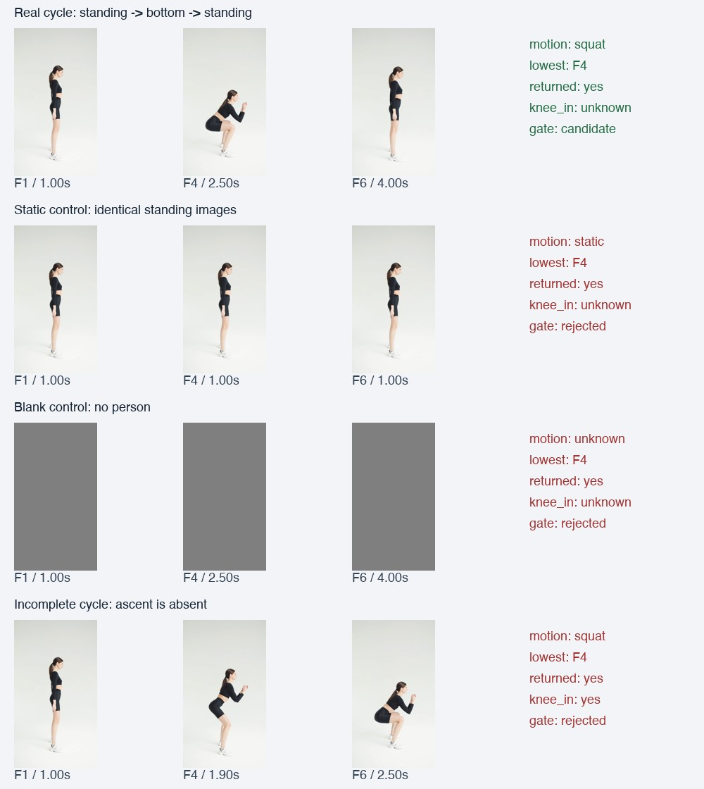

# Qwen3-VL-2B：Mac 真实视频实测

2026-10-16。**完整模型已下载、完整权重SHA已校验、真实推理已跑通；动作判错能力没有通过本轮可用性检查。没有安装或启动iPhone，没有把此VLM加入主App。**

这不是仅凭文件大小或编译作出的判断。跑了Swift MLX、Python MLX-VLM、原始BF16和官方Transformers/PyTorch MPS对照，保留了失败答案。当前不应由这个2B分支直接认定“动作标准”、计次或发布自动纠错建议。

## 权重、设备与测量口径

- Mac：Apple M5 Pro，48GiB统一内存，macOS26.5.1；Xcode26.6、Swift6.3.3。
- 4-bit：`mlx-community/Qwen3-VL-2B-Instruct-4bit`，固定`9c4f5209e57b31f4b9dfba735de3fb983739c9cc`。权重1,782,040,921字节，实际完整SHA256为`4750d95a2162829e127a94e83ac350d498d02070aab216c4687da48804a06ffb`，匹配上游。
- BF16：`Qwen/Qwen3-VL-2B-Instruct`，固定`89644892e4d85e24eaac8bacfd4f463576704203`。权重4,255,140,312字节，实际完整SHA256为`7de1838c87a5349b016c26a1c3f7d2bc400a3d485f95ef39a7059ffd734977a0`，匹配上游。
- 模型、tokenizer及配置存于`~/Library/Application Support/AIFormCoach/Models/`，两套完整文件约6GB。视频数据与大量原始取帧存于本地Caches，不放进App或重复塞入仓库。详细目录及逐文件哈希见[4-bit回执](results/download-receipt.json)、[BF16回执](results/download-receipt-bf16.json)。
- Swift固定MLX Swift LM3.32.3、MLX Swift0.32.3；Python对照固定MLX-VLM0.3.4、Transformers4.57.1、PyTorch2.9.0、Torchvision0.24.0，见[Python依赖快照](results/python-packages.txt)。
- 生产候选输入为**真实视频抽取的有序关键帧**，不是把整段视频每帧送入VLM。每图min65536/max262144像素，6图实际1512个视觉token，总输入1772 token，输出本轮66 token；temperature0，最多192新token，实际输入加输出不得超过4096。官方视频时间戳路径未被冒充成已验证能力。

## 耗时与内存

最终使用Release构建、单调时钟、一个在途任务；文件与Metal缓存已热，连续10次使用**同一组六帧**。这10次衡量性能和重复性，不是10个独立动作准确率样本。没有同时运行相机与MediaPipe。

| 指标 | P50 | P95 / 最大值 |
|---|---:|---:|
| 模型分析和输出，含视觉编码与prefill | 1.14秒 | P95 1.16秒 |
| 首段可见文字 | 0.70秒 | P95 0.71秒 |
| 取帧、预处理、分析合计 | 1.59秒 | P95 1.67秒 |
| 4-bit单请求采样峰值footprint | 2.96GiB | 最大3.02GiB |
| 4-bit整个最终进程峰值footprint | — | `/usr/bin/time -l`约3.10GiB |
| BF16 MLX整个比较进程峰值 | — | 约5.35GiB |
| 官方BF16 PyTorch MPS比较进程峰值 | — | 约7.16GiB |

[最终逐次结果](results/performance-monotonic)；[性能统计](results/performance-monotonic-summary.json)。footprint每50ms采样，另以进程级`time -l`核对；RSS、MLX active/cache/peak也保留，几种内存指标不能互换。取帧合计包含诊断PNG导出开销，不等同最终App的页面等待时间。首段文字不是严格的硬件首token时刻。

最终Release进程首次加载约0.42秒，但完整哈希已经把文件读入缓存，**不能称为冷磁盘启动**。更早首次探索请求曾达到6.78秒，构建、输出长度和缓存条件不同，保留在原始记录，未与最终暖请求混算。真实冷盘、相机并行、长时间发热和iPhone性能尚未测得。

## 动作判断：具体失败在哪里



- **静止站立**：六张完全相同的站姿图，模型能在说明中承认没有下降，却填写`lowest_frame=F4`、`returned=yes`。
- **空白画面**：多帧空白仍可能编造最低点F4，4-bit的结构化输出甚至声称完成回起。不能仅看自然语言中提到“没有人”就认为整条输出可信。
- **截掉上升阶段**：末帧仍处最低姿势，4-bit、BF16 MLX和官方BF16 PyTorch MPS都出现`returned=yes`，凭空补出回起。
- **侧面膝内扣**：给出明确不可判定要求后，部分回答仍填写`knee_in=yes`；此视角没有足够证据支持该结论。
- **严格格式**：初始6个场景中5个原始答案带代码围栏、不能直接作为JSON消费；另有抄写`a|b|c`选项、把时间当帧ID、用字符串代替证据数组、重复至192 token截断等问题。仅移除围栏无法修复事实错误。

[初始失败](results/smoke-initial)、[简化观察任务](results/observer)、[BF16比较](results/bf16-comparison)、[官方PyTorch独立底层比较](results/torch-reference)。Python MLX与Swift MLX共享MLX底层，故又补跑了独立PyTorch MPS。后者同样复现关键反例，不能把这些错误全部归因于Swift接线或4-bit量化。结论限于本模型、本输入预算和本轮任务，不外推为所有VLM都不能评价动作。

### 带作者标签的真实视频抽样

使用论文作者公开的OfficeSquat数据作额外可证伪检查：[论文及下载出处](https://www.frontiersin.org/journals/robotics-and-ai/articles/10.3389/frobt.2022.669719/full)。它是**同一参与者、特定研究动作协议**，含手臂、深浅、倾斜与速度偏差，并非通用徒手深蹲合格标准。实际ZIP含62段AVI，论文描述60段，差异如实记录；标签来自作者文件名，没有自行编造一份专家标注CSV。[数据来源与ZIP哈希](results/office-source.json)。仅本地研究，不据论文开放许可推定视频商业分发许可。

第一次文本目标实验存在定义偏差，18段集中输出同一类，结果保留，不能当严谨总体准确率。随后显式提供作者标为correct的R1–R6参考片，再给F1–F6待评片，每图改为131072像素以维持总预算；短标签输出避免用格式失败掩盖分类问题。

新冻结的12个**未用于提示调试的视频试次**中，4-bit结果只与作者主标签一致**3/12（25%）**。逐类：correct1/2、high0/2、low2/2、tilt0/2、arms0/2、fast0/2。全部是同一人的不同试次，不是人物留出集；一个arms文件带fast次标签、一个fast文件存在平移，均在冻结清单中写明。这个数字只描述此抽样与协议的一致程度，不能写成“健身动作准确率25%”。

[事先冻结标签](results/office-fresh-labels.json)、[固定输入及提示](results/office-word-fresh-suite.json)、[逐例分数](results/office-fresh-score.json)、[全部原始回答](results/office-word-fresh)。BF16在同一开发子集又集中输出另一类，也未证明更高精度能解决本任务；未为得到好看的分数继续修改新留出集。

## 输入与运行时核对

- 固定完整权重SHA后才加载；真实模型active张量存储分别约1.782GB和4.255GB，没有用占位输出、模拟姿态或文字模型替代。
- 单张原始图片的简短描述可以区分蹲姿、站立和空白；文字控制能回答7×8=56、正确否定“静止算一次深蹲”。这说明基本加载和观察链路可以工作，但不证明复杂动作判断正确。
- 对完全相同的保存PNG检查实际归一化patch张量：Swift与HF Python形状和THW一致。彩色测试图不缩放时MAE约9.4e-10，确认通道与patch排列；真实图缩放时MAE约0.00470，灰图约0.00248，**不宣称位级一致**，缩放/渲染差异保留。见[张量数值对照](results/preprocessing-common-png-comparison.json)。
- Swift平衡分块与不分块prefill都试过，不能靠切分策略消除关键误判。Python同权重、原始BF16与官方PyTorch路径也作了交叉比较。

## 本轮修复了什么

实现[ObservationGate](../../Research/Qwen3VL-2026-10-16/preflight/Sources/CoachQwenPreflight/ObservationGate.swift)，在实际实验推理边界启用：

1. 只接受完整JSON或一个完整JSON围栏；验证字段、类型、枚举、长度和真实帧ID。截断、额外文字、未知引用均拒绝。
2. 允许unknown→uncertain这类拒答同义归一化；不把yes改成no伪装模型答对。
3. 拒绝“不是深蹲却完成回起”、全同像素输入编造运动、侧面给膝内扣肯定/否定等矛盾。可接入可靠时序引擎的未完成证据；当前主App尚未接入这个实验模块。
4. 即使通过检查，也只允许作为研究观察候选，`eligibleForAutomaticCoaching`始终false；没有将2B的自由生成建议升级为训练问题。解析合法、候选通过不代表动作判断已被认证。
5. 实验入口在加载权重前拒绝超过12张图、超过像素/输出预算、无效变体和空实验集；任一推理用例异常时进程返回失败，避免只看exit0误认全部成功。5个实际可执行程序边界回归通过，见[结果](results/runtime-guard-regression.json)。
6. 计次继续由已有姿态/时序链路承担。本轮用Mac实际Vision适配器重跑完整真实视频：2秒站稳、5/5；裁切反例0/0。模型不会改写次数。[正例](results/core-count-regression.json)、[反例](results/core-negative-regression.json)。MediaPipe既有回归是另一份证据，本轮内存并非相机+MediaPipe+VLM并发值。

[回归源码](regression/GateRegression.swift)通过11个校验检查和4个真实模型失败输出回归；最终10个正常研究观察可解析为候选，4个不安全控制全部被拦截，全部自动教练发布资格均为false。**修复的是接入防线，模型的事实误判仍判失败，不描述成“算法已经准确”。**

基于真实核心测量的纯文字总结也试过：能说出5次并说明没有确认技术问题，但将“5次动作”说成“5次测量”，仍需审核措辞，不作为建议质量已经验收的证据。[原始结果](results/hybrid-measurement)。

## 复现和文件

```sh
python3 Docs/Testing/Qwen3VL-Mac-2026-10-16/scripts/run_benchmark.py \
  --out /tmp/coach-qwen-repeat

swiftc Docs/Research/Qwen3VL-2026-10-16/preflight/Sources/CoachQwenPreflight/ObservationGate.swift \
  Docs/Testing/Qwen3VL-Mac-2026-10-16/regression/GateRegression.swift \
  -o /tmp/coach-qwen-gate-regression
/tmp/coach-qwen-gate-regression Docs/Testing/Qwen3VL-Mac-2026-10-16/results/observer
```

脚本只构建macOS目标；会重新校验本地模型文件，不只信任旧回执。`--bf16`切换完整原始模型；`--suite`指定冻结实验输入。新环境的Pexels素材参见[原始素材与哈希](../RealSquat-2026-10-15/source-and-preparation.json)，OfficeSquat见本报告出处和本地Caches路径。取帧由每次运行重建；在仓库中保留小型JSON、脚本和诊断拼图，避免几百张重复PNG污染项目。

[执行日志与校验清单](results/execution-manifest.json)记录构建/运行日志哈希及摘录、脚本/Swift源哈希、命令与范围。完整模型没有加入Git，未提交/推送，未进行任何手机安装或启动。

当前建议是保留可靠计次与已确认事实；VLM独立判错分支不进入自动教练。下一轮若要提高质量，需要经教练审核的本动作标签、明确机位和目标，比较更合适的模型/时序分类器或训练；仍以冻结且人物分离的样本验收。手机端延迟、温度、相机并行和实际拍屏问题继续等待用户通知后再测。
